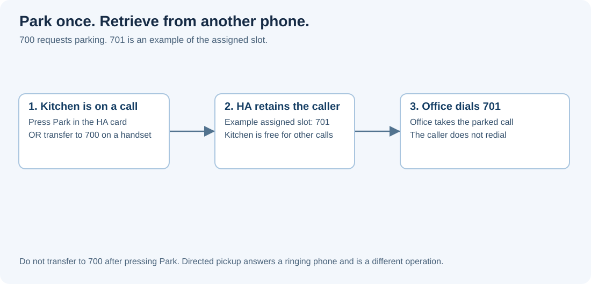

# Call parking and directed pickup

This guide describes the updated 2026.10.3-dev preview. Redownload an older
build with the same version label to receive these additions.

Parking leaves the other party connected to Home Assistant while you put down
your phone. Another phone retrieves that conversation by calling its parking
slot. The caller does not have to redial.

## Enable and configure

Open the integration's main configuration and enable call parking. By default,
parking is disabled and does not reserve any numbers in the dial plan.

The initial settings are:

| Setting | Default | Purpose |
| --- | --- | --- |
| Access number | `700` | Transfer a call here to use the first free slot. |
| Slots | `701` through `720` | Call the occupied slot to retrieve its caller. |
| Parking timeout | 180 seconds | How long the caller can remain parked. |
| Return ringing timeout | 30 seconds | How long the return destination may ring. |
| Return destination | The phone that parked the call | Optional alternate contact. |
| Hold audio | None | Optional media selected through Home Assistant. |

Configured slot numbers must not conflict with existing phones, contacts or
groups. If hold audio cannot be read, the caller remains connected in silence;
the ordinary return timeout still applies.

## One example, without an extra transfer

You are talking on Kitchen and want to continue on Office. Press **Park** on
Kitchen's HA card, or transfer to **700** from a SIP handset. If the assigned slot
is **701**, put Kitchen down and dial **701** from Office. You do not transfer to
700 after parking: the Park button and the transfer to 700 are alternatives.

## From a SIP phone

While speaking to someone, transfer the call to `700`. The PBX retains the
other party and releases your phone. Dial the occupied slot, for example `701`,
from another phone to retrieve the conversation. A transfer to a particular
configured slot parks there; an ordinary call to that same slot retrieves it.
The explicit aliases `park.701` and `pickup.701` distinguish these operations.

Only one phone can retrieve a slot. A failed pickup leaves it available for
another attempt. If the caller hangs up, the slot becomes free immediately.
Registered SIP phones can subscribe to the slot using the SIP dialog event
package (RFC 4235) for a busy-lamp indication.

## From the dashboard card

During an established audio call, **Park call** appears when parking is enabled
in the backend. It invokes the same action described below and displays the
assigned slot. The card does not choose a slot or move media itself. Dial that
slot from the same card or another phone to retrieve its caller. For example,
after **Park** reports **701**, open the keypad, enter **701** and press **Call**.
Do not call 700 to retrieve it: 700 is the parking access number.

These slots belong to VoIP Stack in Home Assistant. A telephone registered to
another PBX, such as FusionPBX, needs a dial-plan route from that PBX to HA's
parking slots. Its own PBX's extension 701 is not automatically HA's slot 701.

Browser-to-browser calls return to the existing local audio bridge after
pickup. SIP participants retain their established SIP dialog and negotiated
media. The phone leaving the call becomes available for another conversation.

## From a Home Assistant action

Select **VoIP Stack: Park call** and choose the phone currently participating
in the conversation. Leave the slot empty to select the first free slot.
The optional response contains `slot`, `call_id` and `generation`.

In the action editor, select **VoIP Stack: Park call**, then select the phone
currently on the call in **Phone**. The response reports the assigned slot.
If a native VoIP trigger already supplies this call, keep that call context.

To retrieve it from another phone, add **VoIP Stack: Call**, select that other
phone in **Calling phone** and enter the reported slot (for example `701`) in
**Destination**. You can also dial the slot on its card or SIP handset.

Only advanced automation code needs to inspect `call_id`, `expected_generation`
or save a response variable. The [action reference](SERVICES.md) documents those
fields; a phone selected with the GUI does not require a hand-written device ID.

## Answer another ringing phone

With parking enabled, dial `pickup.kitchen` to answer the individual phone named
`kitchen`, or `*8101` if its extension is `101`. An occupied parking slot still
uses its normal slot number or `pickup.701`. Slot names take precedence.
The `*8` prefix is reserved while this feature is enabled; it is a local dial-plan
convention, not a standardized SIP feature code. Asterisk also exposes directed
pickup through its dial plan, although its configured access code may differ.

The caller keeps the same call. The original destination stops ringing and the
phone performing pickup becomes the other participant. A simultaneous answer on
the original phone wins if it is already accepted before pickup commits.
Cancelling a pending pickup leaves the original ringing call available.
Pickup also works while a parked caller is ringing its return destination: the
caller keeps its established dialog and the existing RTP socket is handed to
the replacement media owner.

Use an identified phone connected to this HA PBX. For a dashboard phone, enter
the same address in its card or use `voip_stack.call` with that phone selected.
Pickup currently targets individual ringing audio calls, not a conference,
a group branch, an active video call or an Automation-owned announcement.

## Current verification boundary

Real baresip calls cover parking from either SIP participant, pickup, timeout
return, repeated parking, hold/resume and hangup from either side. Audio tests
inspect decoded WAV samples and released RTP reservations. Browser transport
fixtures also cover pickup, parking again and subsequent SIP pickup. Local
browser tests cover parking from either participant, SIP or browser pickup,
subsequent parking in the opposite direction, and injected media-start failure
followed by a successful retry. A failed preparation leaves the original call
and its participants intact.

Two real Chromium phones also completed two consecutive parking/pickup cycles,
including pickup by the phone that originally parked the call. Captured WAVs
contained the other phone's input signal after each completed sequence, and the
final HA diagnostics reported no remaining call resources.

These tests do not qualify every physical handset's transfer button or BLF
configuration. Active video calls are rejected before parking rather than
silently losing their video session. Calls made directly between devices,
without passing through Home Assistant, are outside this parking service.
