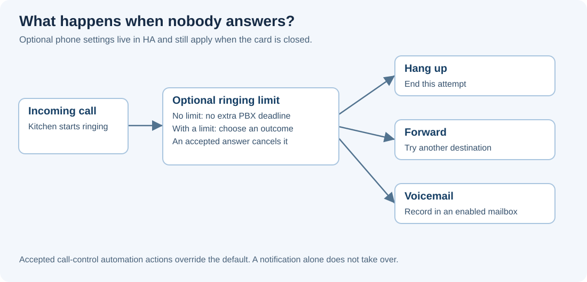

# Phone routing defaults

A phone's routing settings live in Home Assistant. They apply even when its
card is closed, and the ESP mirror card edits the same backend settings as a
softphone card. Direct SIP calls sent to an ESP's IP bypass the HA dial plan.
Use its HA phonebook route when the backend must apply these rules.

Open the phone card's **Options > Call routing**, or choose the native action
**VoIP Stack: Configure phone routing** and select the phone in the device picker.

| Setting | Behavior |
| --- | --- |
| Always forward to | Route new calls to another phonebook destination. |
| When busy or Do not disturb | Use the alternate destination when the phone is already busy, has DND enabled, or returns SIP `486 Busy Here`. |
| When unavailable | Use the alternate destination when the phone is offline or the SIP attempt reports temporary unavailability. |
| Ringing timeout | Optional number of seconds to wait for an answer. |
| When nobody answers | Hang up, forward, or enter an enabled voicemail mailbox. |
| Preferred outgoing SIP trunk | Choose this phone's default provider for external calls. |

With no ringing timeout configured, the PBX adds no application-level ringing
limit. Network failures, caller cancellation and SIP transaction timers still
end failed attempts. A timeout and its outcome are configured together, so
turning on a timeout never silently enables voicemail.

## Choose a simple default first

For a kitchen phone, enable a 20-second ringing timeout and choose **voicemail**.
Leave the destination empty to use the kitchen's mailbox. Enable that mailbox
separately in the phone configuration. To ring another phone instead, choose
**forward** and enter its name or extension.

To set the same policy in an automation, add **VoIP Stack: Configure phone
routing**, select Kitchen in **Phone**, set **Ringing timeout** to 20 and choose
**Voicemail** in **When nobody answers**. The picker saves the phone reference;
no device-ID lookup is required.

Omitted fields keep their current settings. Set the timeout to zero to disable
it, or clear a forwarding destination to remove that rule. The
[action reference](SERVICES.md) retains the advanced field names.

## Let an automation decide

Use a native VoIP call trigger and its normal call-control actions when the
choice depends on time, presence or another HA condition. The trigger binds
that execution to the call. An accepted `forward`, `tts_say`, voicemail or
hangup action controls that call and supersedes its default route.

An automation that only sends a notification does not claim the call. The
configured default remains available. This keeps a notification-only rule from
leaving callers waiting forever. The unanswered trigger also offers a bounded
decision window before the phone's default timeout action runs.

For example, a native unanswered-call automation can speak a greeting and then
use **Send to voicemail**. Once voicemail takes ownership, do not append a
hangup: it owns recording and termination. See the
[automation cookbook](AUTOMATION_DIALPLAN.md) and [voicemail guide](VOICEMAIL.md).

A ring group controls its own attempts and fallback. Individual members do not
apply personal no-answer forwarding while other group phones are still ringing.
Explicit forwarding actions retain their configured failure policy. Routing
loops are rejected rather than creating an unbounded chain of new calls.

Advanced: answers, cancellation and failed destinations

A SIP final answer ends the ringing period. Early media or a provisional `183`
does not count as answering. An already-connected caller can still be waiting
for a different phone, for example during a parking return. The deadline follows
that destination leg, not the caller's answered state. If a phone answers while its audio bridge is being
prepared, the no-answer rule cannot take the call away.

The caller remains on the same call when a failed or unanswered destination is
replaced. Its old SIP transaction is retired by the existing call owner. A slow
CANCEL exchange cannot delay audio to the replacement. Busy fallback does not
convert a `603 Decline` into another call, and authentication/permission errors
are not treated as temporary unavailability.

## Multiple providers

Use **Add SIP trunk** on the integration page to create another named line.
Choose the global default in the main integration configuration. A call action
can select another trunk explicitly; otherwise the phone preference wins over
the global default. An unavailable selected line fails visibly instead of
quietly using a different provider. See [SIP trunk configuration](SIP_TRUNK.md).
