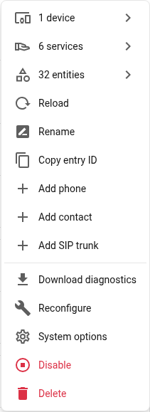
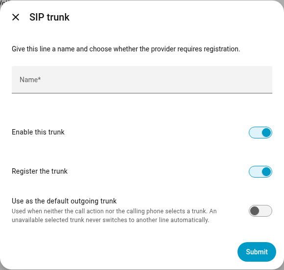

# SIP trunks

Home Assistant can connect named SIP trunks to providers or PBXs, either with
registration or as a static trunk authorized by source IP. This does not change the local contract: ESP devices remain direct SIP
phones and do not register to the provider.

Each trunk has its own connection, credentials and incoming routing settings.
Disabled trunks do not register or accept new external calls. Local calls work
without any trunk configured.

## Which phones may use the trunk?

Every phone is allowed by default. Use **VoIP Stack: Set external call access**
from an automation or Developer tools to restrict a selected browser phone,
SIP account or ESPHome phone. The permission persists through restart and rename.
It controls new outgoing trunk legs routed through HA, including forwarding and
transfers. Incoming and internal calls continue; changing the permission does
not hang up a call already established.

See [the editor walkthrough](AUTOMATION_DIALPLAN.md#control-external-calls-per-phone)
and [permission scope](SERVICES.md#external-call-permissions). This per-phone
permission is separate from the source-IP list that authenticates a static
trunk's incoming traffic.

## Setup flow

The first VoIP Stack setup step configures HA's local SIP
endpoint identity and media ports:

- SIP port
- RTP base port
- advertised host/IP
- optional Assist intents and callable Assist endpoint
- optional SIP/RTP diagnostics
- optional browser SIP video
- optional local SIP registrar

After setting up the integration, open **Settings > Devices & services >
VoIP Stack**, then **three-dot menu > Add SIP trunk**. The integration page also
has an **Add SIP trunk** shortcut. Each line is a separate configuration subentry
with its own device and readiness entity. Use its configuration control to edit
it; the main integration's Reconfigure flow no longer contains provider settings.





The screenshot shows adding an additional line to an existing installation.
Give the line a name, such as Home or Work, and choose **Register the trunk** if
the provider requires account registration. The first trunk automatically becomes
the outgoing default, without a default-selection switch. When adding another
trunk, the form offers **Use as the default outgoing trunk**. The following step
asks for trunk details:

- transport: `udp` or `tcp`; `tls` is available for registered trunks
- server, port and optional domain
- username, optional auth username and password
- REGISTER expiration when registration is enabled
- allowed incoming IP addresses when registration is disabled
- optional outbound proxy
- allowed audio codecs and video codecs for this line
- inbound default target
- incoming routing mode: Direct or DTMF extension selection
- optional experimental automation routing override
- DTMF timeout and optional terminator

Registered trunks are tested before saving. A failed registration leaves the
previous saved configuration and working connection intact. A successful edit
adopts the validated connection; it does not send a second concurrent REGISTER.
Finish active calls before changing a trunk's connection settings. Renaming a
line or editing incoming routing does not replace its connection.

An existing single trunk is migrated to a named **SIP trunk** entry, retaining
its credentials, incoming routing and default selection.

For UDP registrations whose SIP response reports an address or port translated
by NAT, the trunk sends periodic SIP OPTIONS on the registered socket. This
maintains the signaling mapping between REGISTER refreshes without changing
the registration status or creating phone calls. Home Assistant shutdown also
closes the owned registrations before releasing their transports.

### Choose codecs for each trunk

Open the named trunk's configuration and edit **Allowed audio codecs** and **Allowed video
codecs**. These selections apply to incoming and outgoing calls on that line.
Each trunk has independent settings; local ESP and browser calls keep their
own capabilities.

The initial selections preserve the existing codec negotiation. Select only
the encodings supported by your provider or PBX. For example, a voice-only
provider might require PCMA and PCMU with no video codecs selected. A PBX
connection may also support G.722 or Opus. Follow the peer's configuration,
rather than assuming every provider supports the same list.

- At least one audio codec must be selected. A call also needs an actual
  codec in common with the peer and the local media path. Selecting a codec
  does not install a decoder or enable a new transcoder.
- An empty video selection disables video on this trunk. Selecting video
  codecs does not enable the integration's video option or the caller's camera.
- On video-capable calls, **Send Camera** controls transmission. With the
  camera off, the phone can still negotiate video reception (`recvonly`).
  Enabling the camera during the call updates its sending direction.
- The selections are allowlists. Existing codec preferences, RTP payload
  mappings, clock rates and supported H.264 profiles determine the offer.
- DTMF telephone events are negotiated separately from the audio codec list.
- PCM refers to the existing Dahua PCM compatibility format. L16 and L24 are
  separate RTP encodings; their names are not interchangeable.

An established call keeps the policy with which it was negotiated, including
later media updates. Finish active calls before editing the trunk. Calls
without a compatible audio format fail cleanly instead of sending a different,
unselected codec.

### Large SIP invitations

Restricting the codec list to the peer's actual capabilities keeps SDP offers
smaller. It does not replace SIP transport handling: authentication headers can
also make an INVITE grow beyond the safe UDP size.

For an INVITE larger than 1300 bytes with unknown path MTU, the call client
attempts TCP, including when the authenticated retry crosses that threshold.
The trunk's UDP registration remains active. A refused or reset TCP connection
can fall back to the original UDP route before the INVITE is sent; a TCP timeout
does not trigger that fallback. Explicit TCP and TLS settings are not downgraded.
See [RFC 3261, section 18.1.1](https://www.rfc-editor.org/rfc/rfc3261.html#section-18.1.1).

### Route incoming calls to a particular phone

Select the receiving phone under **Fallback destination**, for example
`Bedroom`, and select direct incoming routing. The selector lists configured
phones and contacts; a group, extension or other dial-plan destination can also
be entered. Select the actual Home Assistant phone by its name, rather than
entering the legacy `HA` alias. This is
independent of the outgoing default trunk. A called destination that already
matches the phonebook takes precedence over this fallback target.

Deleting the default trunk clears that selection immediately and does not
choose another provider, even when only one line remains. The integration also
cleans up a stale selection at startup. Home Assistant Repairs explains how to
choose a new default; selecting one clears the notice. Phone-specific or
per-call selections of existing lines continue to work.

### Choose an outgoing line

The selection order is:

1. **Outgoing SIP trunk** in the call or forward action.
2. The calling phone's **Outgoing SIP trunk** preference under its card options,
   also configurable with `voip_stack.set_phone_settings`.
3. The integration's default trunk.

The action editor uses HA's device picker, showing trunk names. It stores a
stable reference. An unavailable selected line produces an error; a working
default or another provider is never substituted silently. Internal calls do
not require a working external line.

Backend announcements can select a trunk as well. Create an Automation contact
named `Wakeup-Caller` and an external phonebook contact named `Delivery phone`,
then use:

```yaml
actions:
  - action: voip_stack.call
    data:
      source_automation: Wakeup-Caller
      destination: Delivery phone
      trunk_id: Work
      answer_timeout: 30
  - action: voip_stack.tts_say
    data:
      tts_entity_id: tts.piper
      message: "A parcel has arrived."
  - action: voip_stack.hangup
```

`Work` is the configured trunk name in this readable example; choose the device
in HA's editor to retain the selection across renames. Replace `tts.piper` with
your TTS entity. No browser or ESP caller is needed. The call action waits for
the remote answer, and the following actions control that execution's call.

### Select a line for one ESP call

The same **Outgoing SIP trunk** selector works when the calling phone is an
ESPHome device. This requires firmware exposing the native actions
`start_call_via_ha` and `hangup_call_if_id` from the matching development branch.
Older firmware can still make ordinary calls and use its persistent phone
preference; choosing a line for one action returns an explicit upgrade message.

In **VoIP Stack: Call**, select the ESP in **Calling phone**, select the named
line in **Outgoing SIP trunk**, and enter the contact or number in **Destination**.
The [action-picker screenshots](USER_GUIDE.md#choose-the-calling-phone-in-the-editor)
show how to choose the phone by name.

Choose the phone and trunk through HA's device pickers. Names are shown in the
editor; the stored device references survive renames. HA allocates a unique
Call-ID, passes it to that ESP through its existing native API connection and
accepts the line selection only on the matching SIP INVITE from that phone for
that destination. The eight-second command deadline waits for this INVITE, not
for the called person to answer. No line preference is written back to the ESP
or saved for its next call.

Cancellation targets that exact Call-ID. A late INVITE from a cancelled action
is rejected, and a missing or unavailable selected line never falls back to
another provider. Persistent phone preferences apply to calls routed through
HA; calls made directly to another device IP bypass these rules.

### Static trunk without REGISTER

Disable **Register the trunk** when the other PBX or provider routes calls to a
fixed SIP address instead of accepting account registrations. In this mode (UDP or TCP):

1. Set **Trunk server** and **Trunk SIP port** to the destination for outbound calls.
2. Add each **Allowed incoming IP address**, or CIDR network, supplied by the provider.
   These are the source addresses of its SIP signaling, which may differ from the
   outbound server. Use literal IPv4/IPv6 addresses or restricted networks; `/0`
   entries are rejected. This list is required and is shown only in static mode.
3. Configure the other system to send inbound calls to HA's reachable SIP address
   and listening port. Without REGISTER, HA does not publish this destination to it.
4. Select the incoming destination or routing automation as usual.

For example, a local gateway at `192.168.1.50:5060` can be both the outbound server
and the allowed incoming address `192.168.1.50`. A provider with several signaling
servers needs each permitted source address or network listed separately.

Username and password are optional in static mode. Keep credentials if the peer
challenges outbound INVITEs; disabling REGISTER does not disable SIP digest support.
The username also supplies the outbound SIP identity when configured.

HA sends no REGISTER, registration refresh or unregister in this mode. OPTIONS
is not used to simulate registration. Availability means the static route is
configured, not that the remote peer has been probed successfully. Calls still
report connection failures normally. The allowed IP list applies to SIP signaling,
not the RTP media addresses negotiated in SDP.

Calls from a matching source use the existing trunk routing rules. Other sources
do not acquire trunk privileges; registered phones and ESP endpoints keep their
existing call paths. Local phonebook destinations, DTMF and automation routing
continue to use the shared call implementation. Static trunks using the same
transport must have non-overlapping incoming source networks, so a request
cannot accidentally be attributed to two lines.

Registered trunks carry a unique `line` parameter in their Contact URI, as used
by PJSIP, to distinguish incoming calls when a provider preserves that Contact.
The source still has to pass its trust checks. If a request matches multiple
lines and cannot be identified unambiguously, it is rejected. Registration flow
identity, incoming line identity and the selected outgoing line remain separate.

### Registered trunk

The REGISTER Request-URI identifies the registrar domain, for example
`sip:example.invalid`. The account address of record remains in `To` and
`From`, for example `sip:alice@example.invalid`. Keeping the username out of
the Request-URI is required by FRITZBox and remains valid for ordinary SIP
registrars. Digest authentication still uses the configured auth username and
realm.

REGISTER runs as a background SIP client transaction. Home Assistant setup
does not block while an unreachable registrar consumes the RFC non-INVITE
deadline. UDP retransmissions retain the same transaction identity, while an
authenticated retry after `401` or `407` uses a new CSeq and Via branch.

## Outbound routing

Local targets still resolve through the phonebook first.

- `sip:name@host:port` routes direct.
- A known phonebook name routes direct or via HA according to the roster.
- A logical name can be bridged by HA.
- A contact `number` or unresolved external-looking number can route through
  the available trunk. Local/internal digits should be modeled as
  `extension`.

In registration mode, the trunk must be registered before routing unresolved
outbound targets. In static mode, the configured route is available without
registration. There is no proprietary intercom compatibility route.

## Inbound routing

Provider inbound calls arrive at HA's SIP endpoint and use the shared phonebook
as their default dial plan. **Fallback destination** accepts a phonebook name,
extension, group, registered SIP phone, Assist extension, SIP URI or routable
number. Select the actual HA phone by its displayed name.

Choose one routing mode in that named trunk's configuration:

- **Route immediately** first resolves the destination from the incoming SIP
  request against the phonebook. A known extension or contact keeps its normal
  routing and availability rules. Only an unknown destination uses **Fallback
  destination**. Routing automations can override this choice; their event retains
  the original called address in `target_route`, `dialed_target` and
  `called_extension`, including when the fallback points to Assist or a group.
- **DTMF extension selection** answers the trunk leg with SDP, collects
  negotiated telephone-event or SIP INFO digits, and resolves explicit digits
  as phonebook extensions.

DTMF digits resolve against the central phonebook `extension` field:

For example, assign extension `100` to the Kitchen phone in its configuration.
For an ESP, edit its exposed extension control. Creating a name-only contact
does not create a physical or browser phone: the destination must be callable.

Example user flow:

1. A caller dials the public provider number.
2. HA answers the trunk leg.
3. The caller sends post-dial digits such as `100`.
4. HA routes the call to the phonebook entry whose `extension` is `100`.
5. If no digits/route hint arrive before timeout, HA resolves the configured
   fallback destination selected for that trunk.
6. If explicit digits arrive but do not resolve, HA terminates the answered leg
   as `route_not_found`.

No final `#` is required. `trunk_dtmf_terminator` can be set if a deployment
wants one, but the normal path is a short timeout. Ambiguous prefixes are
resolved against the live phonebook extensions: HA collects within the timeout,
tries the final digit buffer, and fails loudly if that explicit buffer cannot
be resolved.

The route collector prefers negotiated RTP `telephone-event` and also accepts
the widely deployed legacy SIP INFO DTMF representation. Acoustic in-band
tones are not decoded.

## Experimental automation override

**Allow experimental automation routing overrides** is a separate switch and
is disabled by default. Enabling it adds one bounded `route_requested` decision
point:

- Direct mode exposes it before the default target.
- DTMF mode exposes it only after the digit window produced no digits.
- Explicit DTMF digits always retain priority and never enter the automation
  path.

If no matching automation acts within 1.5 seconds, the original phonebook route
continues. This makes time, presence and other HA state useful for contextual
routing without replacing the normal dial plan. See
[Automation Dial Plan](AUTOMATION_DIALPLAN.md) for native UI-compatible
examples.

Version 1 entries migrate without changing their route. Existing DTMF-enabled
entries with a non-zero timeout become DTMF mode; other entries become Direct
mode. Automation routing stays off until explicitly enabled.

## Media

The provider leg and local leg are separate SIP dialogs. HA bridges RTP between
them with the same relay/resampler used for local HA bridge calls. ESP firmware
uses PCM or compile-time Opus according to its profile. HA trunk and softphone
legs may accept common SIP codecs such as Opus, G.722, PCMA or PCMU, then convert
toward the negotiated ESP format when the route requires it. Unsupported media
is rejected with standard SIP errors.

RTP packet duration is treated as a negotiated target, not an assumption about
every received datagram. When the codec, sample rate, channel count and PCM
layout already match, shorter aligned packets are accumulated and emitted at
the destination frame size. This supports peers that advertise 16 or 20 ms but
send 10 ms PCMA/PCMU packets without hiding malformed or unaligned payloads.

## Observability

The HA softphone snapshot exposes:

- `sip_trunk.trunk_enabled`
- `sip_trunk.trunk_registered`
- `sip_trunk.trunk_status_code`
- `sip_trunk.trunk_status_reason`
- `sip_trunk.trunk_last_sip_event`
- `sip_trunk.trunk_transport`
- `sip_trunk.trunk_server`

INFO logs describe normal call progress. DEBUG logs should be used when tracing
REGISTER, INVITE, DTMF routing and RTP relay behavior.

### Outgoing media through NAT

If Home Assistant calls a remote PBX through NAT, **Outbound media IPv4 address**
in that trunk's configuration lets HA advertise its reachable address for audio
and video. Leave it empty for the existing behavior, including trunks on your
LAN or VPN. Enter HA's public IPv4 address, not the provider's address.

This setting applies to calls originated through the selected trunk, including
subsequent media renegotiation. It does not change SIP registration, local socket
binding, LAN calls or calls arriving from a trunk. RTP and RTCP must be reachable
at the advertised ports, with no port translation. Configure the corresponding
restricted port forwarding when the remote peer cannot establish symmetric RTP.
An address override alone does not create firewall rules or discover NAT mappings.
Update the setting if your public address changes.

Why this matters for video: some cameras send their H.264 decoding parameters
only at call startup. A PBX that first sends video to an unreachable private
address and then learns the public address from RTP may lose those parameters.
Audio can work while the video remains undecodable. Advertising the correct
media destination avoids relying on that late address correction.

For audio/video negotiation and re-INVITE propagation through a FreeSWITCH-based
PBX, see [FreeSWITCH and FusionPBX interoperability](FREESWITCH.md).
